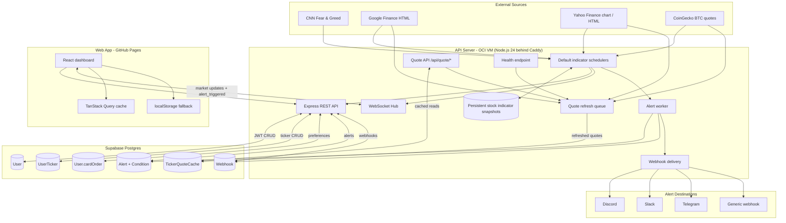

# fg-index

Real-time market dashboard for sentiment, volatility, crypto, indices, and custom tickers. The web app tracks the CNN Fear & Greed Index, VIX, BTC, S&P 500, and up to 32 user-defined symbols, with signed-in sync, server-side alerts, and webhook notifications.

## Live

| App | URL |
|-----|-----|
| Web dashboard | https://itswcl.github.io/fg-index/ |
| API | https://fg-index-api.duckdns.org |

The web app is served by GitHub Pages; the API runs on OCI behind Caddy. See [Deployment and CI](#deployment-and-ci) for release operations and health checks.

---

## Current Product

### Market Data

- **Default cards** - CNN Fear & Greed, CBOE VIX, BTC, and S&P 500.
- **Custom ticker cards** - Up to 32 tickers per user; supports stocks, indices, futures-style Yahoo symbols such as `ES=F`, and the BTC crypto quote `BTC-USD`.
- **Batch quote loading** - Visible custom tickers are fetched with `GET /api/quote/batch`, capped at 12 symbols per page, instead of one request per card.
- **Persistent quote cache** - Custom ticker responses are stored in Postgres via `TickerQuoteCache`; request handlers serve the latest known quote while a bounded refresh queue updates stale symbols in the background.
- **Source links** - Cards and mobile rows can open their source page when the backend provides `sourceUrl`.
- **After-hours context** - Custom equity quotes can carry `marketSession`, pre-market, and post-market fields; the UI shows a moon badge and paints the extended-hours price when the data is available.
- **Last-known display** - The frontend hydrates cached quotes from localStorage and keeps good quotes visible through transient scraper misses. Cached stock reads remain available outside refresh hours; see [Refresh Schedule and Cached Reads](#refresh-schedule-and-cached-reads).

### Dashboard UX

- **Desktop grid** - Drag-to-reorder card grid with 12 cards per page and up to 3 pages.
- **Ticker groups** - A default group plus up to 12 custom groups, with synced names, order, and ticker membership.
- **Mobile line-item layout** - Phones switch to compact metric rows with swipe pagination and an explicit edit mode for reorder/delete so normal vertical scrolling remains reliable.
- **Stable loading states** - Initial signed-in hydration pads the grid/list with placeholders so cards and pagination do not jump as preferences and tickers load.
- **Theme support** - Dark, light, and system theme modes.
- **Connection status** - WebSocket status is debounced so short reconnects do not flash error states.

### Accounts, Alerts, and Notifications

- **Supabase Google sign-in** - Authenticated APIs use Supabase JWTs.
- **Cross-device sync** - Alerts, webhook destinations, custom ticker lists, ticker groups, and card order persist in Supabase Postgres.
- **Signed-in alerting** - The current web UI gates alert and webhook management behind Google sign-in.
- **Anonymous fallback** - LocalStorage backs unsigned ticker/order sessions and acts as the migration source for older local alerts after sign-in.
- **Server-side alerts** - Alerts are stored in Postgres and evaluated by the API server on each default market-data update, so delivery does not depend on the browser staying open.
- **Multi-webhook delivery** - Each user can save up to 10 webhook destinations. Supported types are Discord, Slack, Telegram, and generic JSON POST.
- **Fan-out notifications** - Triggered alerts deliver to every enabled webhook for that user and also push `alert_triggered` to any live authenticated WebSocket connections.

---

## Monorepo Structure

```text
apps/
  api-server/     Express REST + WebSocket API, schedulers, alert worker, Prisma/Postgres
  web/            React + Vite dashboard deployed to GitHub Pages
  macos-app/      React Native macOS legacy companion
packages/
  shared-types/   Shared schemas, types, limits, and Pacific market-window rules
docs/
  *.md            Product specs and historical design notes
ops/
  deployment/     OCI release operations and systemd deployment cadence
  oci/            API service unit and Caddy configuration
  release-poller/ Artifact verification and staging
```

The active product is the web app plus API server. The macOS app is retained as legacy code; see [`docs/README-macos-legacy.md`](docs/README-macos-legacy.md).

---

## Architecture



### Data Flow

1. Default indicator schedulers update memory caches and broadcast `FEAR_GREED_UPDATE`, `VIX_UPDATE`, `BTC_UPDATE`, and `SPX_UPDATE` over WebSocket. Configured disk snapshots restore Fear & Greed, VIX, and SPX after restarts.
2. Custom ticker requests read the memory/Postgres quote cache, return a quote or `null`, and enqueue eligible refresh work without waiting for an upstream scrape.
3. The quote worker scans tracked symbols and refreshes stale quotes with bounded concurrency and per-symbol failure cooldown. Stock refresh eligibility follows the shared market window; BTC runs all week.
4. Authenticated users persist alerts, webhook destinations, card order, and tickers through REST APIs.
5. The alert worker evaluates default-market alerts on scheduler updates and fans out delivery to all enabled webhook destinations.

---

## Data Sources and Resilience

| Area | Primary path | Fallback / guard |
|------|--------------|------------------|
| Fear & Greed | CNN DataViz JSON | Last-known memory cache and optional restart snapshot |
| VIX | Google Finance with forced English locale | Yahoo Finance HTML fallback |
| S&P 500 | Google Finance with forced English locale | Yahoo chart JSON, then Yahoo HTML |
| BTC | CoinGecko simple price | 60-second quote cache; no alternate provider |
| Custom stocks/indices | Google Finance parser | Yahoo chart/HTML, exchange suffix resolution, last-known cache |
| Custom quote serving | Postgres `TickerQuoteCache` | Background refresh queue with cooldown and health stats |

Scraping remains the highest operational risk. Parser tests cover known Google/Yahoo shapes, and `validateTickerQuote` enforces a complete-quote-or-null contract so `NaN` or partial numeric payloads do not reach clients.

---

## Refresh Schedule and Cached Reads

Stock upstream fetching and stock/mixed alerts run from **06:00 inclusive to 15:00 exclusive, America/Los_Angeles**, Monday through Friday, excluding standard full-day US exchange holidays. Pacific daylight saving changes are automatic. Full-day holiday rules follow the [NYSE calendar](https://www.nyse.com/trade/hours-calendars), including observed holidays and Good Friday. Early-close days retain this fixed application window for extended-hours quotes; extraordinary exchange closures are not predicted. BTC fetching and BTC-only alerts remain available 24/7.

Outside that window, browsers may read the last cached stock snapshot once per query/page and keep its original timestamp; periodic stock polling and upstream refreshes pause. Mixed stock/BTC pages continue polling BTC without repeatedly requesting stock snapshots. Cached stock quotes remain readable across weekends and holidays even when older than 24 hours; BTC retains its normal age limit. The cadence below applies during the window for stocks and all week for BTC.

| Data | Backend cadence | Browser HTTP polling |
|------|-----------------|----------------------|
| Fear & Greed | 10 min | 10 min |
| VIX | 10 sec after each fetch; widens to 30 sec when fetching takes over 8 sec; separate 5-min fallback | 3 min |
| S&P 500 | 10 sec after each fetch; widens to 30 sec when fetching takes over 8 sec | 3 min |
| BTC | 60 sec; 60-sec quote freshness | 30 sec |
| Custom tickers | 30-sec scan; 60-sec quote freshness; starts spaced at least 3 sec apart, 2 workers | 10-sec visible-page batch |

Default indicators also arrive over WebSocket; their HTTP polling currently runs alongside push updates. Custom tickers have no WebSocket quote channel. Intervals are code defaults; API environment overrides can change backend values.

Set `INDICATOR_SNAPSHOT_DIR` to a service-writable persistent directory to restore Fear & Greed, VIX, and SPX after an API restart. The OCI unit uses `/var/lib/fg-index/indicators` with `StateDirectory=fg-index`; writes atomically replace each complete JSON snapshot, and missing/invalid files are ignored. The first deployment cannot restore values never saved by an earlier process. Without this setting, default indicator snapshots remain in memory only. Custom ticker snapshots continue using Postgres.

Market status is checked locally every minute, with upstream refresh slots at 06:00, 06:25, 06:30, 06:35, 12:55, 13:00, and 13:05 Pacific plus startup inside the window. An API key and enabled market-status refreshes are required. Market-status refresh failures retry once per minute, for at most five attempts including the initial attempt, then wait for the next scheduled slot. Startup refreshes follow the same retry policy. Retries stop outside the stock window; successful slots are marked complete only after provider fetch and required session persistence succeed.

Default stock fetch loops resume within 30 seconds of opening. Quote queues reject off-window stock work, including requests from clients. An alert combining BTC and stock metrics waits for the stock window, including OR alerts. Settings, authentication, and WebSocket connections remain available all week. Health reports `stockUpdatesPaused: true` while stocks are paused and continues checking BTC freshness.

---

## Getting Started

### Prerequisites

- Node.js 24.22.1 or newer within Node 24 is required by the workspace, API, and frontend. Run `nvm install && nvm use` to select the patched version in `.nvmrc`; CI and GitHub Pages builds use the same file. The OCI service uses its separately installed runtime, which must also be upgraded (see `ops/oci/README.md`).
- npm bundled with the selected Node version.
- Supabase project for auth and persistence.
- Postgres connection strings for Prisma migrations.

### API Server

Create `apps/api-server/.env.local`:

```bash
CNN_FEAR_GREED_URL=https://production.dataviz.cnn.io/index/fearandgreed/graphdata/
GOOGLE_FINANCE_VIX_URL=https://www.google.com/finance/quote/VIX:INDEXCBOE
YAHOO_FINANCE_VIX_URL=https://finance.yahoo.com/quote/%5EVIX/
GOOGLE_FINANCE_BTC_URL=https://www.google.com/finance/quote/BTC-USD
YAHOO_FINANCE_BTC_URL=https://finance.yahoo.com/quote/BTC-USD
GOOGLE_FINANCE_SPX_URL=https://www.google.com/finance/quote/.INX:INDEXSP
YAHOO_FINANCE_SPX_URL=https://finance.yahoo.com/quote/%5EGSPC/
SCRAPER_USER_AGENT=Mozilla/5.0 ...
DATABASE_URL=postgresql://...
DIRECT_URL=postgresql://...
SUPABASE_URL=https://<project>.supabase.co
SUPABASE_JWKS_URL=https://<project>.supabase.co/auth/v1/.well-known/jwks.json
```

Run locally:

```bash
npm ci --workspaces=false --prefix packages/shared-types
cd apps/api-server
npm ci --workspaces=false
npm run build
npm run prisma:migrate
npm run dev
```

Run the installation commands from the repository root. `npm run build` builds shared types, generates the Prisma client, and builds the API. `npm run prisma:migrate` loads `.env.local` for development migrations.

The API and WebSocket server share port 8080 by default. Schedulers start by default and contact real upstream providers; set `SCHEDULERS_ENABLED=false` to disable periodic schedulers on additional API processes. Quote read requests can still enqueue eligible background refreshes.

### API Environment Variables

| Variable | Default | Description |
|----------|---------|-------------|
| `PORT` | `8080` | HTTP + WebSocket port |
| `HOST` | `0.0.0.0` | Listen address; OCI binds to `127.0.0.1` behind Caddy |
| `SCHEDULERS_ENABLED` | `true` | Start indicator, custom quote, and market-status schedulers; enable on only the designated scheduler owner |
| `INTERNAL_API_KEY` | `dev-key-123` | API key for public read endpoints; the default disables enforcement in development and is rejected in production |
| `CORS_ORIGIN` | `*` | Comma-separated allowed origins |
| `CNN_FEAR_GREED_URL` | required | CNN Fear & Greed JSON endpoint |
| `GOOGLE_FINANCE_VIX_URL` | required | Google Finance VIX page |
| `YAHOO_FINANCE_VIX_URL` | required | Yahoo VIX fallback |
| `GOOGLE_FINANCE_BTC_URL` | required | Legacy BTC URL env required by config |
| `YAHOO_FINANCE_BTC_URL` | required | Legacy BTC URL env required by config |
| `GOOGLE_FINANCE_SPX_URL` | required | Google Finance S&P 500 page |
| `YAHOO_FINANCE_SPX_URL` | required | Yahoo S&P 500 fallback |
| `SCRAPER_USER_AGENT` | required | Browser User-Agent for upstream requests |
| `FEAR_GREED_INTERVAL_MS` | `600000` | Fear & Greed scheduler interval (10 minutes) |
| `INDICATOR_SNAPSHOT_DIR` | empty | Optional durable directory for validated Fear & Greed, VIX, and SPX restart snapshots |
| `VIX_REALTIME_INTERVAL_MS` | `10000` | VIX realtime loop interval before adaptive throttling |
| `VIX_FALLBACK_INTERVAL_MS` | `300000` | VIX fallback refresh interval |
| `BTC_INTERVAL_MS` | `60000` | BTC scheduler interval |
| `SPX_INTERVAL_MS` | `10000` | S&P 500 realtime loop interval before adaptive throttling |
| `QUOTE_REFRESH_INTERVAL_MS` | `30000` | Active custom ticker sync interval |
| `QUOTE_REFRESH_CONCURRENCY` | `2` | Max concurrent background quote refresh workers |
| `QUOTE_REFRESH_SPACING_MS` | `3000` | Minimum spacing between background quote refresh starts to avoid provider bursts |
| `QUOTE_REFRESH_FAILURE_COOLDOWN_MS` | `60000` | Per-symbol refresh cooldown after failure |
| `BACKGROUND_DB_FAILURE_COOLDOWN_MS` | `60000` | Shared cooldown for background DB jobs after Supabase/Prisma connectivity failures |
| `QUOTE_STOCK_CACHE_TTL_MS` | `60000` | Freshness TTL for stock/index quote cache rows before background refresh refetches upstream |
| `QUOTE_MEMORY_CACHE_TTL_MS` | `120000` | In-process quote read cache TTL to reduce database egress |
| `QUOTE_NULL_CACHE_TTL_MS` | `120000` | In-process null quote cache TTL to avoid repeated database misses |
| `ACTIVE_SYMBOL_CACHE_TTL_MS` | `300000` | In-process active ticker symbol cache TTL for background scheduler scans |
| `ALERT_CANDIDATE_CACHE_TTL_MS` | `300000` | In-process enabled alert candidate cache TTL for alert worker DB reads |
| `QUOTE_FETCH_TIMEOUT_MS` | `5000` | Upstream fetch timeout for quote sources |
| `QUOTE_PRICE_SANITY_MAX_MOVE_PERCENT` | `100` | Reject quote refreshes whose price moves by this percent or more from the previous cached price; set `0` to disable |
| `AUTH_USER_UPSERT_TTL_MS` | `300000` | In-memory TTL for skipping repeated authenticated user upserts |
| `MASSIVE_API_KEY` | empty | Optional Massive API key for low-frequency market-session status refreshes |
| `MASSIVE_MARKET_STATUS_URL` | `https://api.massive.com/v1/marketstatus/now` | Massive market-status endpoint |
| `MARKET_STATUS_REFRESH_ENABLED` | `true` | Set `false` to disable Massive market-session refreshes |
| `DATABASE_URL` | required | Supabase pooled Postgres connection |
| `DIRECT_URL` | required | Direct Postgres connection for migrations |
| `SUPABASE_URL` | required | Supabase project URL |
| `SUPABASE_JWKS_URL` | required | Supabase JWKS endpoint for JWT verification |

### Web App

Create `apps/web/.env.local`:

```bash
VITE_API_URL=http://localhost:8080
VITE_API_KEY=dev-key-123
VITE_SUPABASE_URL=https://<project>.supabase.co
VITE_SUPABASE_ANON_KEY=<anon-key>
```

Run locally:

```bash
cd apps/web
npm ci --workspaces=false
npm run dev
```

| Variable | Description |
|----------|-------------|
| `VITE_API_URL` | Backend base URL |
| `VITE_API_KEY` | Sent as `X-API-KEY` for public read endpoints |
| `VITE_WS_URL` | Optional explicit WebSocket URL; derived from `VITE_API_URL` if omitted |
| `VITE_SUPABASE_URL` | Supabase project URL for sign-in |
| `VITE_SUPABASE_ANON_KEY` | Supabase public anon key |

Configure both browser Supabase variables even when testing unsigned use: the app constructs its auth client at startup. Use the public anon key, never a service-role key. Google sign-in is required for synced preferences and server-side alert/webhook management.

---

## API Reference

### Public Read APIs

Market-data endpoints require `X-API-KEY` in production. The development default `INTERNAL_API_KEY=dev-key-123` bypasses that check and is rejected at production startup.

| Endpoint | Method | Description |
|----------|--------|-------------|
| `/api/fear-greed` | `GET` | Latest Fear & Greed scheduler cache |
| `/api/vix` | `GET` | Latest VIX scheduler cache |
| `/api/btc` | `GET` | Latest BTC scheduler cache |
| `/api/spx` | `GET` | Latest S&P 500 scheduler cache |
| `/api/quote/:ticker` | `GET` | Cached custom quote snapshot; enqueues refresh when eligible |
| `/api/quote/batch?symbols=AAPL,MSFT` | `GET` | Up to 12 deduped cached quotes; refresh eligibility follows the market window |

`GET /api/health` and its alias `GET /health` require no API key. They return scheduler, quote-refresh, market-status, and alert-worker diagnostics, including `stockUpdatesPaused`.

Batch quote response (quote shape abbreviated here; real quotes include `previousClose`, `change`, `changePercent`, and `fetchedAt`):

```json
{
  "quotes": {
    "AAPL": { "ticker": "AAPL", "price": 182.1 },
    "BAD": null
  }
}
```

### Authenticated APIs

Send `Authorization: Bearer <supabase-access-token>`.

| Endpoint | Method | Description |
|----------|--------|-------------|
| `/api/alerts` | `GET` / `POST` | List or create alerts |
| `/api/alerts/bulk` | `POST` | Replace all alerts for migration |
| `/api/alerts/:id` | `PUT` / `DELETE` | Update or delete an alert |
| `/api/webhooks` | `GET` / `POST` | List or create webhook destinations |
| `/api/webhooks/:id` | `PUT` / `DELETE` | Update or delete one webhook destination |
| `/api/webhooks/:id/test` | `POST` | Test one saved webhook destination |
| `/api/webhooks/me` | `GET` / `PUT` / `DELETE` | Legacy single-webhook alias mapped to the user's oldest webhook row |
| `/api/webhooks/me/test` | `POST` | Legacy test endpoint for the oldest webhook row |
| `/api/user/preferences` | `GET` / `PUT` | Persist `cardOrder` |
| `/api/user/tickers` | `GET` / `POST` / `PUT` | List, add, or bulk-replace custom tickers |
| `/api/user/tickers/:symbol` | `DELETE` | Remove a custom ticker |
| `/api/user/ticker-groups` | `GET` / `POST` | List or create ticker groups |
| `/api/user/ticker-groups/reorder` | `PUT` | Reorder groups |
| `/api/user/ticker-groups/migration` | `PUT` | Migrate local ticker groups |
| `/api/user/ticker-groups/:groupId` | `PUT` / `DELETE` | Rename or delete a group |
| `/api/user/ticker-groups/:groupId/tickers` | `POST` / `PUT` | Add a ticker or replace group membership |
| `/api/user/ticker-groups/:groupId/tickers/:symbol` | `DELETE` | Remove a ticker from a group |

### WebSocket Protocol

The WebSocket server shares the HTTP host/port and sends cached default-indicator snapshots on connection. An optional Supabase JWT in `?token=<access-token>` enables user alert delivery; anonymous connections receive market snapshots. Custom ticker cards use HTTP batch polling. Connections and upgrades are bounded globally and per IP; the payload limit is 4 KiB.

| Message | Direction | Description |
|---------|-----------|-------------|
| `FEAR_GREED_UPDATE` | Server to client | New Fear & Greed snapshot |
| `VIX_UPDATE` | Server to client | New VIX snapshot |
| `BTC_UPDATE` | Server to client | New BTC snapshot |
| `SPX_UPDATE` | Server to client | New S&P 500 snapshot |
| `alert_triggered` | Server to client | Authenticated user's alert matched |

Client-to-server WebSocket messages are no longer part of the active protocol. Alerts and webhooks persist through REST APIs.

---

## Alerts and Webhooks

Alerts are created in the web app's Alerts panel. Each alert supports:

- 1 to 5 conditions.
- `AND` or `OR` logic.
- Operators: `<`, `>`, `<=`, `>=`, `==`.
- Metrics: `fearGreed`, `vix`, `btc`, and `spx`.
- Per-alert cooldown from 0 minutes to 7 days, defaulting to 5 minutes.

Example:

```text
Fear & Greed < 10 AND VIX > 30
```

Webhook destinations support:

| Type | Required fields |
|------|-----------------|
| Discord | Webhook URL |
| Slack | Incoming webhook URL |
| Telegram | Bot token and chat ID |
| Generic | Webhook URL; receives JSON |

Webhook delivery accepts HTTPS destinations on port 443 without URL credentials or fragments.
Every delivery resolves and checks both IPv4 and IPv6 answers, rejects private and
special-purpose addresses (including mixed public/private DNS answers), and pins
its TLS socket to a validated public IP while checking the original hostname's
certificate. Redirects are rejected; use the destination's final HTTPS URL.
This applies to Discord, Slack, Telegram, generic hooks, and saved-webhook tests.
Existing HTTP, private, custom-port, credential-bearing, or redirecting destinations
must be updated before they can deliver. Delivery/test errors give a fixed safe
message without echoing destination URLs or bot tokens.

The service allows four active deliveries and at most 64 waiting calls; an
8-second deadline includes waiting, DNS, connection, and response completion.
Payloads are capped at 16 KiB, response headers at 16 KiB, and response bodies at
64 KiB. Over-budget or failed deliveries remain best-effort and are not retried.
The removed ad-hoc `POST /api/webhooks/test` route is unavailable; use a saved,
JWT-authenticated webhook test route. These limits contain resource use but do
not make arbitrary public webhook recipients trusted or prevent notification spam.

---

## Database

PostgreSQL is accessed through Prisma. Core models:

| Model | Purpose |
|-------|---------|
| `User` | Supabase user mirror with email and `cardOrder` |
| `UserTicker` | Per-user custom ticker list and order |
| `UserTickerGroup` / `UserTickerGroupItem` | Named groups, group order, and ticker membership |
| `TickerQuoteCache` | Persistent quote snapshots plus refresh metadata |
| `Alert` / `Condition` | Server-side threshold alerts |
| `Webhook` | N-per-user webhook destinations |

Development migrations are part of [API setup](#api-server). For production, supply `DATABASE_URL` and `DIRECT_URL` through the deployment environment, then run `npm run prisma:deploy` from `apps/api-server`. The release installer does not run migrations; application rollback does not roll back the database.

---

## Deployment and CI

| Area | Platform | Trigger / Notes |
|------|----------|-----------------|
| API | OCI VM, Caddy, systemd, Node 24 | Verified current-main release, installed by the deployment service |
| Frontend | GitHub Pages | Push to `main` or manual dispatch of `deploy-frontend.yml` |
| Database | Supabase Postgres | Explicit Prisma migrations, separate from release installation |
| CI | GitHub Actions | Operations tests and unit checks, API build/type-check/tests, frontend type-check/build |
| Availability monitoring | UptimeRobot | External endpoint monitoring; independent of release selection |

### API release flow

1. Main CI builds the production archive and generates its provenance attestation.
2. `publish-api-release.yml` publishes the successful main build as an immutable per-commit GitHub release.
3. OCI's deployment service starts the unprivileged poller, verifies the current-main artifact, and promotes it into an inactive release directory.
4. The installer selects `/opt/fg-index/current` and restarts `fg-index-api.service`. One deployment timer runs roughly every 10 minutes; there is no separate poller timer.

The API is the scheduler owner; Render remains suspended. The installer keeps the selected and previous releases, caps staged releases at three, and preserves disk/inode reserves. Failed artifact verification leaves the selected release untouched. Runtime health is checked separately, and rollback is an explicit operator action rather than an automatic health gate.

The service handles `SIGTERM`/`SIGINT` by draining HTTP, WebSocket, and in-flight alert work for up to 20 seconds, then allowing up to 5 seconds for database shutdown. systemd allows 30 seconds before forcing termination. Webhook delivery remains best-effort during shutdown.

For install, restart, and rollback commands, use [OCI release operations](ops/deployment/README.md). For runtime setup, environment handling, snapshot storage, and Caddy, use [OCI service configuration](ops/oci/README.md).

### Verification

From the repository root, after installing dependencies as described above:

```bash
cd apps/api-server
npm run build
npx tsc --noEmit
npm test

cd ../web
npm run lint
npm run build
```

The API test runner supplies dummy environment defaults. Live-server integration tests and the live CNN test are excluded from the default suite; see `apps/api-server/vitest.config.ts`. CI also runs the release poller, promoter, deployment, bootstrap, and systemd contract checks.

For a deployed API, `GET /health` reports current data availability and freshness. A successful workflow or recorded release selection alone does not establish application health.

### Contribution workflow

- Branch from fresh `origin/main`, with one PR per task.
- Keep review branches to one commit unless the reviewer asks otherwise.
- Preserve default-card response contracts: VIX returns `ticker: "VIX"`, S&P 500 returns `ticker: "SPX"`, and BTC uses the canonical `BTC-USD` quote.
